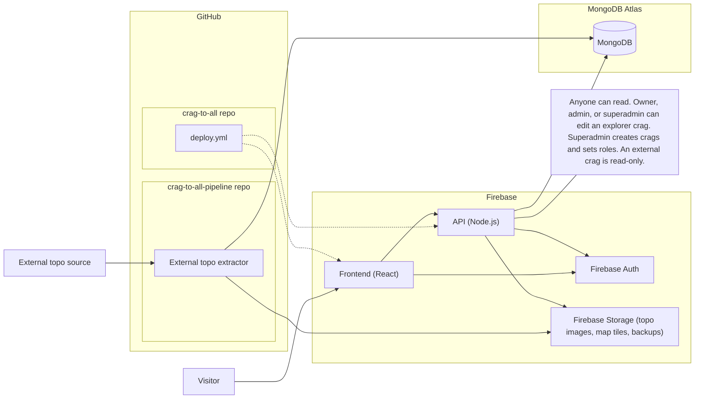

# Crags-for-All

A web application for browsing climbing crags. Open it in a browser, or install it on a phone like a native app (it is a [progressive web app](https://developer.mozilla.org/en-US/docs/Web/Progressive_web_apps)).

The live site is **[roshkaclimb.ge](https://roshkaclimb.ge/)** — currently covering Roshka, Georgia.

You can look up sectors and routes, view topo photos with line overlays, check grades and descriptions, watch beta videos, use the map (including your location), and download PDF guides and GPX tracks. Before a trip with no signal, download a crag in the app so topos, routes, and the outdoor/topo map still work offline.

## Versions

Two major versions. Refer to a change as **v1** or **v2** when it belongs to one of them.

**v1** is `main`, and what [roshkaclimb.ge](https://roshkaclimb.ge/) runs in production. External crags only. Crag documents, images, GPX, PDF guides, and map tiles come from public Firebase Storage. There is no API and no database.

**v2** is this branch (`managed-crags`). It keeps external crags and adds explorer crags that can be authored in the app: Firebase Auth, MongoDB through `crag-api`, and an explorer admin UI. It runs locally, and a manual pre-prod rollout can deploy it. The live site is still v1.

The rest of this document describes **v2**. Crag documents and GPX come from `crag-api`. Images and map-tile packs come from Firebase Storage. PDF links still point at Storage. The daily job does not upload PDFs.

## Architecture



The Frontend is [`crag-explorer`](crag-explorer/) on Firebase Hosting. The API is [`crag-api`](crag-api/) on Firebase App Hosting. The Frontend signs in with Firebase Auth. The API checks that ID token. The superadmin flag is a custom claim on the Auth user. Owner and admin are rows in MongoDB `crag_members`.

MongoDB Atlas is the hosted database for pre-prod and for the daily job. The cluster name is not in this repo. The database name is `crag-to-all`. A laptop uses MongoDB on `127.0.0.1` instead.

Firebase Storage holds topo images, map-tile packs, and backups. Backups are the history copies under `crags/{id}/history`.

`deploy.yml` in this repo is the manual pre-prod deploy. `data-update.yml` in the private `crag-to-all-pipeline` repo runs the external topo extractor (`crag-extract`) every day, and on demand. That job logs in to the external topo source, writes external crags to MongoDB, and uploads images, tile packs, and a JSON copy to Storage. The Frontend reads crag documents from the API, so it does not read that JSON copy. The job leaves explorer crags unchanged. It does not upload PDF guides.

## Packages

| Path                                             | Role                                             |
| ------------------------------------------------ | ------------------------------------------------ |
| [`crag-explorer/`](crag-explorer/)                           | Vite + React explorer (Firebase Hosting) |
| [`crag-api/`](crag-api/)                                     | Local Express API (port 3010) + MongoDB documents |
| [`packages/shared-crag/`](packages/shared-crag/)             | Shared TypeScript types, geo, Bézier, and GPX helpers |
| [`packages/shared-firebase/`](packages/shared-firebase/)     | Firebase Admin SDK, Auth and Storage emulators, Storage rules, and the MongoDB client |

Hosting is configured in [`firebase.json`](firebase.json). App Hosting for the API is configured in [`crag-api/apphosting.yaml`](crag-api/apphosting.yaml).

## Quick start

Requires **Node 24**.

```bash
npm run build-shared-crag
cd crag-explorer
npm ci
npm run dev
```

`npm run dev` loads crag documents from the local API (Vite proxies `/api` to port 3010) and files from production Firebase Storage. Install MongoDB locally (default `mongodb://127.0.0.1:27017`), then start the API:

```bash
npm run dev:api
```

In another terminal, from `crag-explorer`:

```bash
npm run dev
```

To point file URLs at the local emulators (Storage on port 9199, Authentication on port 9099):

```bash
npm run emulator:start
```

Accounts created in the Auth emulator are stored in gitignored `emulator-data` with the Storage files. The emulator UI at http://localhost:4000 shows those users and password-reset messages.

In another terminal:

```bash
cd crag-explorer
npm run dev-local
```

See [`crag-api/README.md`](crag-api/README.md) and [`crag-explorer/README.md`](crag-explorer/README.md). `dev-local` signs in against the Auth emulator. Writes send that Firebase ID token as a bearer token. Reads stay anonymous. The explorer still shows edit controls for every signed-in user. The API allows an explorer-crag change when the ID token custom claim `superadmin` is boolean `true`, or when that user is an owner or admin. Extracted crags stay read-only. A production explorer build signs in against Firebase Authentication when the web config is set. Phone auth stays off, and the project must not be upgraded to Identity Platform. Set `VITE_API_BASE_URL` (no trailing slash) on production builds once the API is public. Image upload uses the Storage emulator via Admin SDK.

## Build

```bash
npm run build
```

[`.github/workflows/deploy.yml`](.github/workflows/deploy.yml) tests `crag-api` and `crag-explorer` on every pull request and on `main`. A manual run on the `pre-prod` environment rolls out `crag-api` to Firebase App Hosting, then deploys `crag-explorer` to Firebase Hosting.

The daily extract is `data-update.yml` in the private `crag-to-all-pipeline` repo. It runs the external topo extractor (`crag-extract`).

## License

MIT
